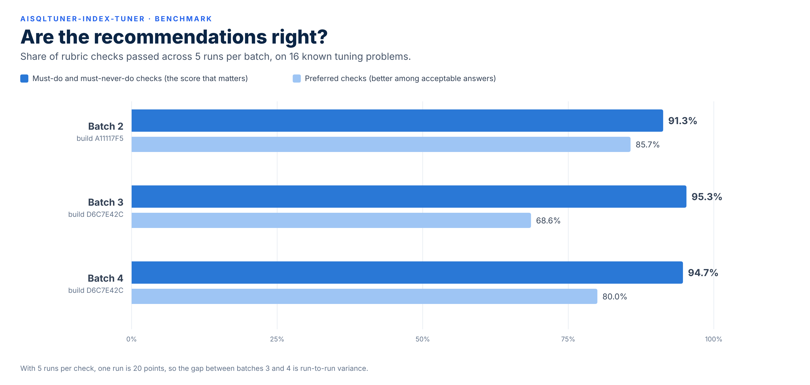
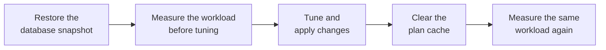
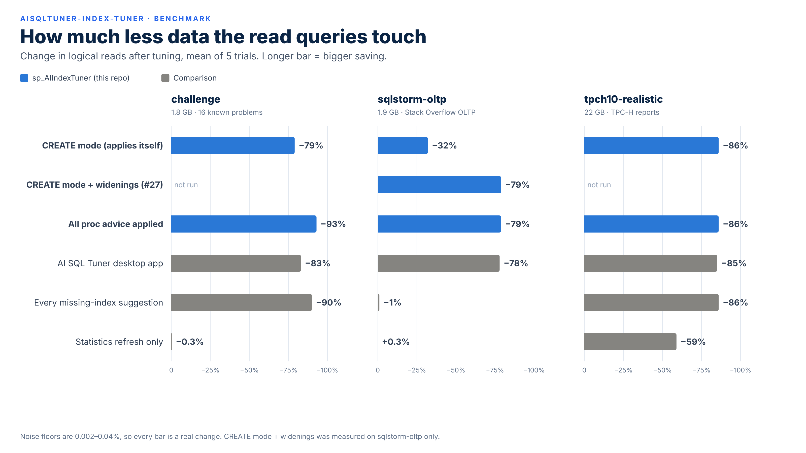
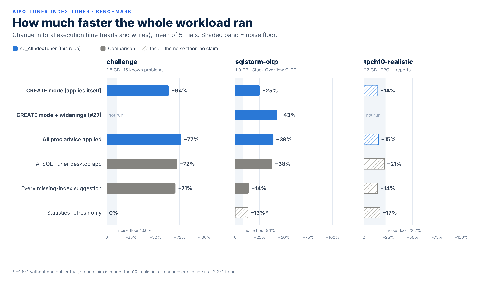
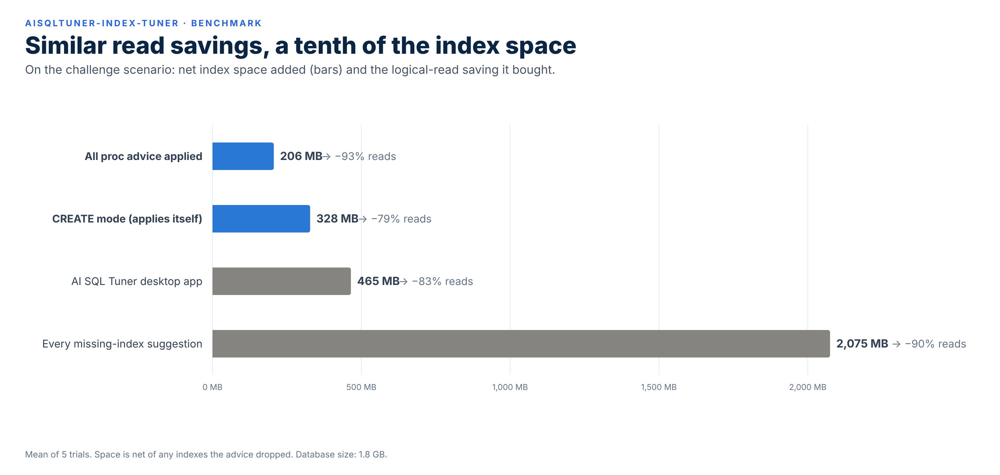

# Benchmark

We tested `sp_AIIndexTuner` to answer two questions ([issue #2](https://github.com/AI-SQL-Tuner/aisqltuner-index-tuner/issues/2)):

1. **Is its advice right?** We built a database with 16 known indexing problems and graded the advice against an answer key.
2. **Does following the advice help?** We ran three workloads before and after tuning, and measured how much less work SQL Server did. We compared the proc with three alternatives: the AI SQL Tuner desktop app, SQL Server's own missing-index suggestions, and a plain statistics refresh.

## The short version

- **The advice passed 91–95% of the checks that matter most**: what it must recommend and what it must never recommend. The two runs of the current version scored 95.3% and 94.7%.
- **Following all of its advice cut the data read by queries by 79–93%**, the best or close to the best of every approach tested, in all three workloads.
- **The whole workload ran 39–77% faster** in the two workloads where the timing is reliable enough to judge. In the third, timing varied too much between runs to make any claim.
- **It got there with far less disk.** On the challenge database it used 206 MB of new indexes. Creating every missing-index suggestion SQL Server makes used 2,075 MB for a similar result, and on another workload those suggestions did almost nothing.
- **No query returned different results** after tuning, in any of the 80 trials.

**Test setup:** every result comes from the `gpt-5.6-luna` model at `medium` reasoning effort, with 5 runs per test, on SQL Server 2025 Enterprise Developer Edition (`VMEnt\SQL25`: 4 vCPU, 31 GB of memory, MAXDOP 4).

## Terms used on this page

| Term | Meaning |
|---|---|
| **Logical reads** | How many 8 KB pages SQL Server read to answer a query. Fewer reads means less work. It is the main measure here because it barely changes from run to run |
| **Read CPU** | CPU time spent on the read queries |
| **Total execution time** | Wall-clock time for the whole workload, reads and writes together |
| **Noise floor** | How much a measure changes between two runs when *nothing* was tuned. A change smaller than this could be chance, so **we make no claim about it** |
| **Arm** | One way of tuning the database, such as "apply everything the proc recommends". Each arm is tested on its own copy of the database |
| **Trial** | One full before-and-after run of one arm. Each arm had 5 trials |
| **CREATE mode** | `sp_AIIndexTuner @Mode = 'CREATE'`: the proc builds the indexes it can validate itself. Riskier changes, such as drops, filtered and columnstore indexes, are left for a person to review |
| **Widening** | Adding columns to an existing index instead of creating a new one |

## Part 1: is the advice right?



### How it was tested

The challenge database ([bench/challenge/](bench/challenge/)) contains 16 deliberately planted problems, each in its own table or set of tables in a `bench` schema:
- filters on columns with few distinct values, or very uneven values;
- 10M- and 5M-row fact tables that should get columnstore indexes;
- a queue table with heavy writes, where extra indexes hurt;
- overlapping suggestions, key column order, and `nvarchar(max)` columns in INCLUDE;
- predicates that can't use an index, duplicate indexes, a heap, and an untrusted foreign key;
- a failed forced plan, scoping to one table, and a short usage history.

An answer key of 37 checks grades each run. Each check is one of three kinds:
- **Required:** advice the model must give.
- **Forbidden:** advice the model must never give.
- **Preferred:** a better answer among several acceptable ones.

Four altered inputs test robustness: a long usage history, an attempt to hijack the model through text hidden in a query (prompt injection), a Standard Edition server, and an input of over 550,000 characters.

[bench/CASES.md](bench/CASES.md) explains each problem and why its expected answer is correct.

### Results

| Batch | Proc version (system prompt hash) | Required + forbidden | Preferred | Report |
|---|---|---:|---:|---|
| 2 | `A11117F5` | **91.3%** | 85.7% | [batch 2](bench/results/rubric-20261028-1401-VMEnt-SQL25-batch2.md) |
| 3 | `D6C7E42C` (adds widenings, #27) | **95.3%** | 68.6% | [batch 3](bench/results/rubric-20261030-0910-VMEnt-SQL25-batch3.md) |
| 4 | `D6C7E42C` | **94.7%** | 80.0% | [batch 4](bench/results/rubric-20261030-0945-VMEnt-SQL25-batch4.md) |

**Required + forbidden is the score to watch**: it covers what the model must do and what it must never do. Each check runs 5 times, so a single run moves a check's score by 20 points. Batches 3 and 4 used the same proc version; their difference is normal run-to-run variation.

## Part 2: does following the advice help?

### The three workloads

| Workload | Database | What runs |
|---|---|---|
| **challenge** | `IndexTunerChallenge`, 1.8 GB: the Part 1 database | 13 reads and 3 committed writes, at least one per problem |
| **sqlstorm-oltp** | `SQLStormOltp`, 1.9 GB: a Stack Overflow sample with a one-column index on every foreign key | 4,000 short reads and 480 committed writes per pass |
| **tpch10-realistic** | `tpch10`, 22 GB: TPC-H at scale factor 10, with triggers that keep summary tables up to date | 6 reports based on TPC-H queries, plus 2 refresh writes that are rolled back |

### The five ways of tuning (arms)

| Arm | Label in the charts | What gets applied |
|---|---|---|
| `proc-create` | CREATE mode (applies itself) | Only what `sp_AIIndexTuner @Mode = 'CREATE'` validates and builds on its own |
| `proc-reviewed` | All proc advice applied | Every script the proc recommends, as a DBA who follows all of the advice would apply them |
| `desktop` | AI SQL Tuner desktop app | Every script from the [AI SQL Tuner](https://aisqltuner.com) desktop app's IndexTuning goal |
| `naive-missing-index` | Every missing-index suggestion | One index for each suggestion in SQL Server's missing-index DMVs, exactly as suggested. No AI involved |
| `stats-only` | Statistics refresh only | `UPDATE STATISTICS ... WITH FULLSCAN` on the workload's tables and nothing else. This shows how much of a gain comes from fresh statistics alone |

### How each trial runs

The method comes from the desktop app's `bench` harness (AI-SQL-Tuner/aisqltuner, [#247](https://github.com/AI-SQL-Tuner/aisqltuner/pull/247)).



- Each measurement includes warm-up passes, which are discarded, followed by measured passes.
- Every trial of an arm gets the exact same input, so differences between trials come from the model and the server, not the data.
- The 5 trials of each arm run in random order.
- The noise floor for each workload comes from trials where nothing was tuned, measured the same way.

### What was measured

| Kind | Measure |
|---|---|
| **Benefit** | **Logical reads** of the read queries (the headline measure, because its noise floor is close to 0%) |
| | Read CPU |
| | Total execution time |
| | Number of queries that got faster, stayed the same, or got slower |
| **Cost** | Disk space added by new indexes, minus any indexes dropped |
| | Extra cost to write queries, reported separately from the benefit |
| **Quality** | Scripts applied, blocked or failed |
| | Queries that returned different rows after tuning |
| **Efficiency** | Read reduction per GB of index added |
| **Running cost** | Model tokens and tuning time |

### Results: data read by queries



Every change in this chart is real: the noise floor for logical reads is 0.04% or less in all three workloads.

### Results: total execution time



Solid bars are changes larger than the noise floor. Hatched bars are inside it, so they could be chance.
- **challenge:** following the advice cut total time by two-thirds to three-quarters.
- **sqlstorm-oltp:** it cut total time by about 40%.
- **tpch10-realistic:** timing varied by up to 22.2% between untuned runs, and every arm's change is smaller than that. **This workload can't show whether any arm made it faster.** Its logical reads and CPU are steady, so read those instead.

### Results: disk space



### Full results (mean of 5 trials)

**Logical reads / read CPU / disk space added:**

| Arm | challenge | sqlstorm-oltp | tpch10-realistic |
|---|---|---|---|
| `proc-create` | −79% / −66% / 328 MB | −32% / −34% / 26 MB | −86% / −23% / 6.4 GB |
| `proc-create` with widenings (#27) | not run | −79% / −60% / 42 MB | not run |
| `proc-reviewed` | −93% / −81% / 206 MB | −79% / −54% / 37 MB | −86% / −17% / 5.2 GB |
| `desktop` | −83% / −74% / 465 MB | −78% / −53% / 34 MB | −85% / −13% / 3.6 GB |
| `desktop`, rerun after its script fixes (AI-SQL-Tuner/aisqltuner#253, AI-SQL-Tuner/aisqltuner#254) | not run | not run | −86% / −23% / 5.3 GB |
| `naive-missing-index` | −90% / −72% / 2,075 MB | −1% / −19% / 13 MB | −86% / −23% / 5.8 GB |
| `stats-only` | −0.3% / 0% / none | +0.3% / −2% / none | −59% / −13% / none |
| *Noise floor (reads / CPU)* | *0.002% / 11.6%* | *0.04% / 15.8%* | *0.03% / 4.3%* |

**Total execution time** (bold = larger than the noise floor):

| Arm | challenge | sqlstorm-oltp | tpch10-realistic |
|---|---:|---:|---:|
| `proc-create` | **−63.9%** | **−25.1%** | −14.2% |
| `proc-create` with widenings (#27) | not run | **−43.1%** | not run |
| `proc-reviewed` | **−76.6%** | **−39.2%** | −14.9% |
| `desktop` | **−72.4%** | **−38.0%** | −21.1% |
| `desktop`, rerun after its script fixes | not run | not run | −7.9% |
| `naive-missing-index` | **−70.7%** | **−13.9%** | −14.1% |
| `stats-only` | 0.0% | −12.9%, or −1.8% without one outlier trial | −16.5% |
| *Noise floor* | *10.6%* | *8.1%* | *22.2%* |

**No query returned different results** in any of the 80 trials, including the desktop rerun, and no trial was flagged as suspect.

### What the results show

1. **Following all of the proc's advice is the best approach, or close to it, in every workload.** On the challenge workload it beat the desktop app on reads and CPU while using less than half the disk space. On the other two it matched the desktop app.
2. **CREATE mode alone gets most of the benefit.**
   - **challenge:** it falls behind because it leaves filtered and columnstore indexes for a person to review.
   - **sqlstorm-oltp:** it fell behind because the model often recommended the fix as a widening of an existing index, which CREATE mode didn't apply at first. Since [#26](https://github.com/AI-SQL-Tuner/aisqltuner-index-tuner/issues/26), CREATE mode widens indexes itself, and it now matches the full advice here (−79% reads).
   - **tpch10-realistic:** it ties the other approaches.
3. **SQL Server's missing-index suggestions are unreliable.**
   - **challenge:** close to the best on reads, but with ten times the disk space.
   - **sqlstorm-oltp:** almost no benefit (−1% reads). It never suggested the two ordered, covering indexes that matter.
   - **tpch10-realistic:** every approach built the same four indexes it suggested, so all tie.
4. **Writes pay a price where expected, and can also gain.** New indexes made some writes more expensive: 47–100% more reads on the challenge workload's FactEvents writes, depending on the arm, and 13% more on sqlstorm-oltp's vote insert. On tpch10-realistic the refresh writes got about 80% cheaper, because a new index speeds up a lookup inside a trigger.
5. **Refreshing statistics alone did nothing on two workloads and a lot on the third.** On tpch10-realistic it cut reads by 59%, all of it on one query, whose plan improved once its statistics were built from a full scan instead of the default sample. None of the AI tools recommended this.

Detailed reports, with results per trial and per query:
- [challenge](bench/results/impact-20261028-VMEnt-SQL25-challenge.md)
- [sqlstorm-oltp](bench/results/impact-20261030-VMEnt-SQL25-sqlstorm-oltp.md)
- [tpch10-realistic](bench/results/impact-20261030-VMEnt-SQL25-tpch10-realistic.md)

Each report explains how to rerun its tests.

## Limits

- **One model at one effort level.** Other models and effort levels haven't been tested yet.
- **The proc and the desktop app received different inputs.** Each tool used its own data collector, so the comparison covers the collector, the prompt and the scripts together, the way each product actually runs.
- **Three workloads.** They are synthetic or derived from benchmarks, not recorded from production systems.

## Not done yet

| Item | Status |
|---|---|
| **Rerun Part 1 automatically when the prompt or collector changes**, so a change that lowers a score is caught before it is merged | **Deferred.** A real run needs a SQL Server 2025 instance, a live model endpoint and a batch of paid model calls, so it can't run in CI as the repo stands. Until then, run `Run-Rubric.ps1 -Mode Live` by hand after a prompt or collector change, as was done for #27 (batches 3 and 4). `-Mode Validate` uses canned answers, needs no endpoint, and checks the answer key itself |
| Part 1 on Azure SQL Database (the Dev EMS database, limited to the `bench` schema) | Not run yet. `Run-Rubric.ps1 -Azure` supports it ([PREREQUISITES.md](bench/PREREQUISITES.md)) |
| A Database Engine Tuning Advisor (`dta`) arm | Planned for a later comparison; outside the initial scope |

## Rerun the benchmark

**Part 1:** see [bench/PREREQUISITES.md](bench/PREREQUISITES.md).

```powershell
.\bench\Run-Rubric.ps1 -Server localhost -Mode Validate -Scale 0.1 -Reps 60   # canned answers, no endpoint
.\bench\Run-Rubric.ps1 -Server VMEnt -Mode Live                                # gpt-5.6-luna, medium, 5 iterations
```

**Part 2:** run the desktop app's `bench` harness on the SQL Server host:

```
bench validate | prepare | noise-floor --scenario <scenario>.json --server <server>
bench matrix --scenario <scenario>.json --server <server> --effort medium --replicates 5 --models <arms>
```

Each report lists its exact commands and test matrices. All raw results are stored in the harness's `TunerBench` database.

The charts on this page are generated by [diagrams/benchmark-charts.py](diagrams/benchmark-charts.py) from the numbers above. See [diagrams/README.md](diagrams/README.md) to regenerate them.
