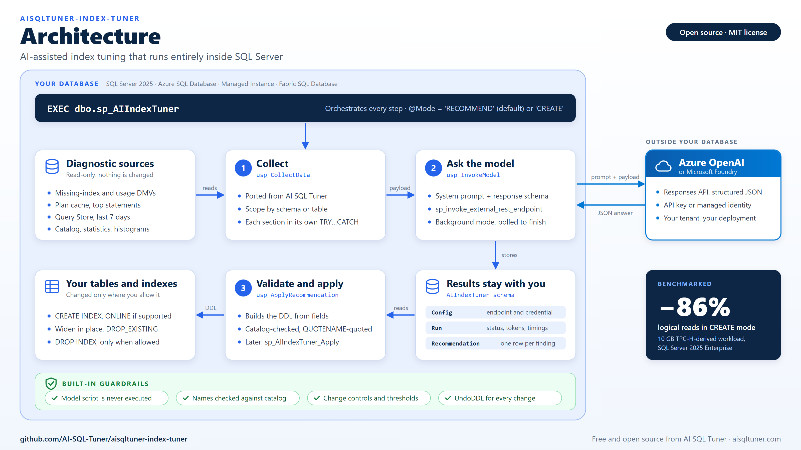
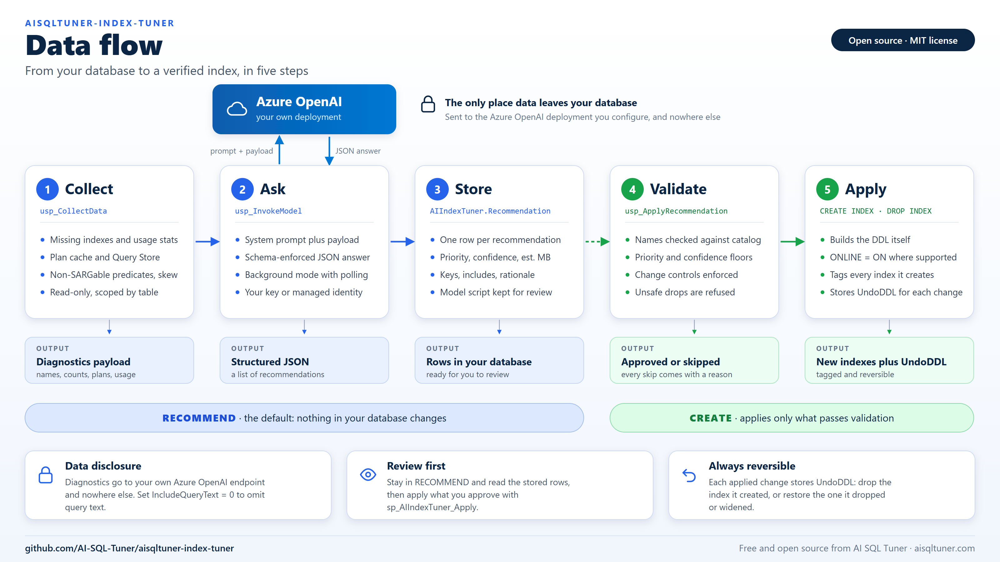
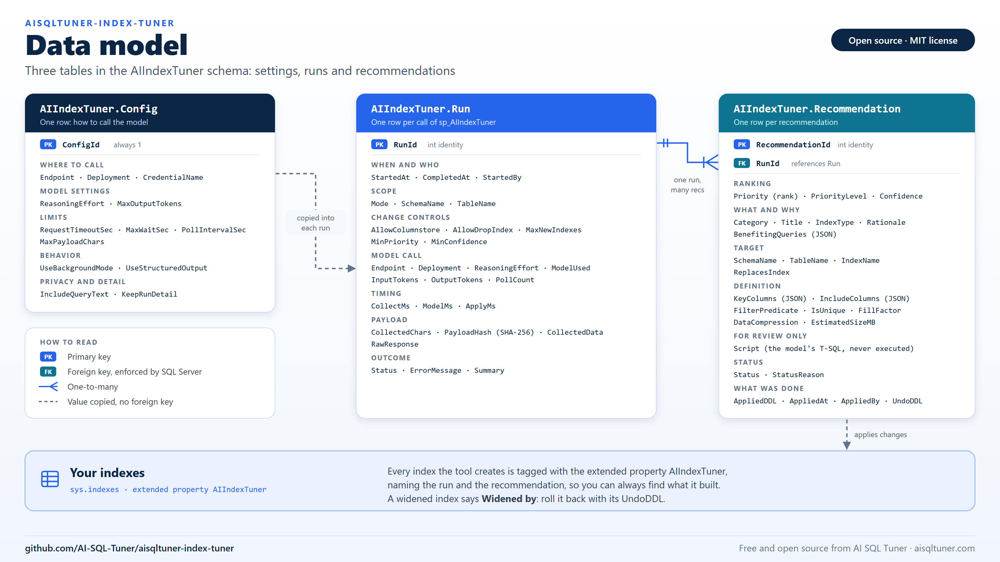
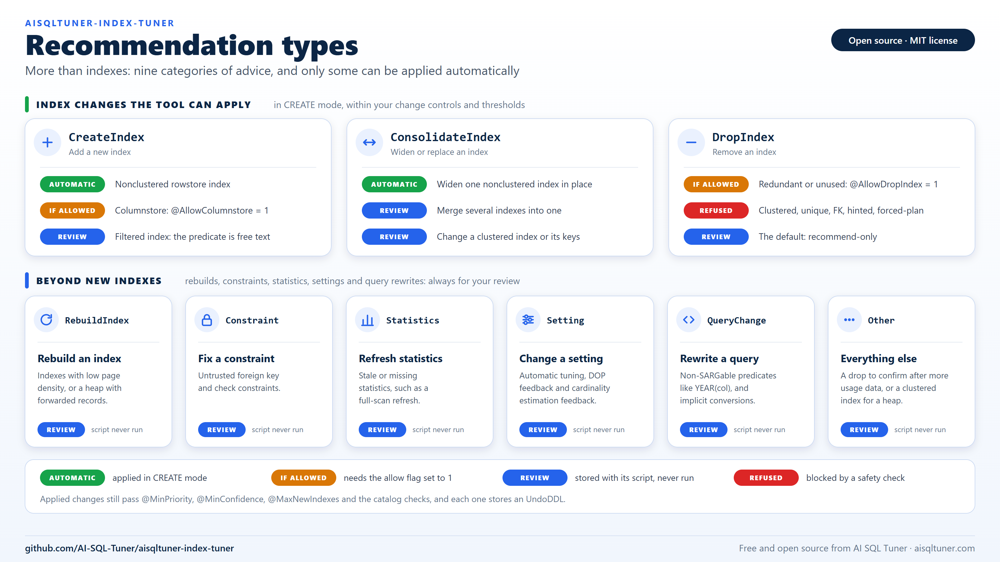

# Diagrams

Four diagrams of how aisqltuner-index-tuner works, for the README, blog posts and social media.
Each comes as an SVG (sharp at any size, editable in a text editor) and a 3200 x 1800 PNG
(16:9, ready to upload to LinkedIn, X or a slide deck).

| Diagram | Shows | Files |
|---|---|---|
| **Architecture** | What lives where: the stored procedures and tables inside your database, the diagnostic sources they read, and the one outside service they call | [SVG](architecture.svg), [PNG](architecture.png) |
| **Data flow** | How data moves through the five steps, from collection to a verified index with an undo script, and where `RECOMMEND` stops and `CREATE` continues | [SVG](data-flow.svg), [PNG](data-flow.png) |

| **Data model** | The three `AIIndexTuner` tables, their columns by purpose, the foreign key from `Recommendation` to `Run`, and the extended property that tags the indexes the tool creates | [SVG](data-model.svg), [PNG](data-model.png) |

| **Recommendation types** | The nine recommendation categories, and which can be applied automatically, which only when you allow it, and which always stay for review. Shows that the output covers more than new indexes | [SVG](recommendation-types.svg), [PNG](recommendation-types.png) |









## Re-rendering the PNGs

Edit the SVG, then render it with headless Chrome or Edge. The size is 1600 x 900 at 2x:

```powershell
$chrome = 'C:\Program Files\Google\Chrome\Application\chrome.exe'
foreach ($name in 'architecture', 'data-flow', 'data-model', 'recommendation-types') {
    Start-Process $chrome -Wait -ArgumentList @(
        '--headless=new', '--hide-scrollbars', '--force-device-scale-factor=2', '--window-size=1600,900',
        "--screenshot=$PWD\$name.png", "file:///$("$PWD\$name.svg" -replace '\\', '/')")
}
```

The SVGs use the Segoe UI and Consolas fonts, with generic fallbacks, so the PNGs are the safest
format for posting. Keep the numbers in the diagrams in step with the [README](../README.md) and
[BENCHMARK.md](../BENCHMARK.md): the architecture diagram's `-86%` is the CREATE-mode logical-read
reduction on `tpch10-realistic`.
